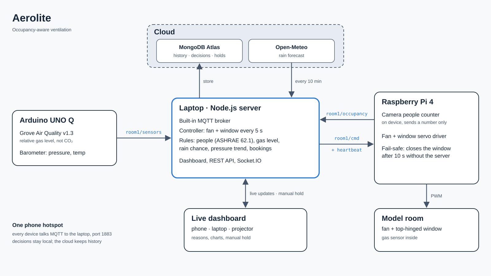

# Nimbus: occupancy-aware ventilation

**Ventilation that follows people, reads the clouds, and explains itself.**
Built at HackRPI 2026, theme "In the clouds."

Nimbus counts the people in a room and watches the air going stale. It then
runs the fan and opens or closes the window on its own. It keeps the window
shut when rain is likely or the pressure is falling, and explains every
decision in one plain sentence on a live dashboard.



## How it works

| Part | Runs on | Job |
|---|---|---|
| Sensors | Arduino UNO Q | Grove Air Quality v1.3 (relative gas level), barometer (pressure + temperature). Publishes `room1/sensors` over MQTT |
| People counter | Raspberry Pi 4 + camera | Counts people on the device and publishes `room1/occupancy`. Only the number leaves the Pi, never an image |
| Fan + window | Raspberry Pi 4 | Drives the fan and the window servo from `room1/cmd`. Closes the window on its own if the server goes quiet for 10 s |
| Server + controller | Laptop (Node.js) | Built-in MQTT broker. Decides fan and window every 5 s from people, air, weather and bookings, using ASHRAE 62.1 airflow rates. Serves the live dashboard |
| Cloud | MongoDB Atlas, Open-Meteo | Time series history, decision log, rain forecast |

The three "clouds": the **breath cloud** a full room produces, the **rain clouds**
that decide whether the window opens, and **the cloud** that stores and shows it all.

## Run it

```bash
cd nimbus-dashboard
npm install
npm run demo        # no hardware, no database: three simulated rooms
```

Open http://localhost:3000. For the real room plus simulated ones, the
MQTT topics, MongoDB setup and the API, see
[nimbus-dashboard/README.md](nimbus-dashboard/README.md).

## Repository

```
nimbus-dashboard/            server, controller, dashboard, simulator
  documents/NIMBUS_PROJECT.md  master project document (design, wiring, message formats, rules, demo plan)
  documents/SUBMISSION.md      submission writeup
pi4/                         people counter + fan/servo driver
unoq/                        UNO Q sensor sketch + bridge (in progress)
```

## Privacy

The camera's only output is a number. Frames are never stored or sent.
Simulated rooms are labeled "Simulated" on screen, and the demo rain setting
is labeled as a demo setting.
